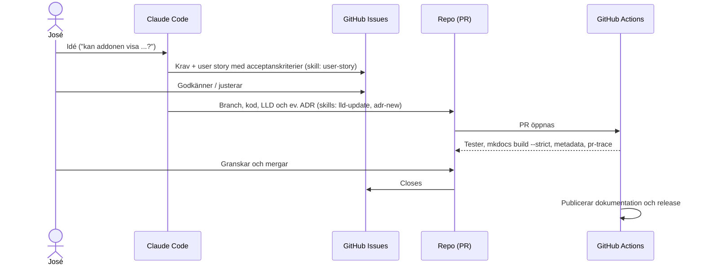

# Från idé till release

## Steg för steg

1. **Idé.** Skriv den som du brukar, kort och med vad du vill uppnå. Claude gör om den till ett krav och en eller flera stories med skillen `user-story`.
2. **Ready.** Storyn har acceptanskriterier och hör till ett krav (se [DoR](dor-dod.md)).
3. **Bygg.** Arbete på en branch. Ändras designen uppdateras `docs/lld.md` i samma PR (`lld-update`). Ett vägval blir en ADR (`adr-new`).
4. **PR.** PR-mallen frågar efter story, krav, dokument och test. `pr-trace` kontrollerar länkarna.
5. **Merge.** Storyn stängs automatiskt. Kravet stängs när alla stories är klara.
6. **Release.** En tagg `vX.Y.Z` ger en release med ändringslogg från PR:erna.
