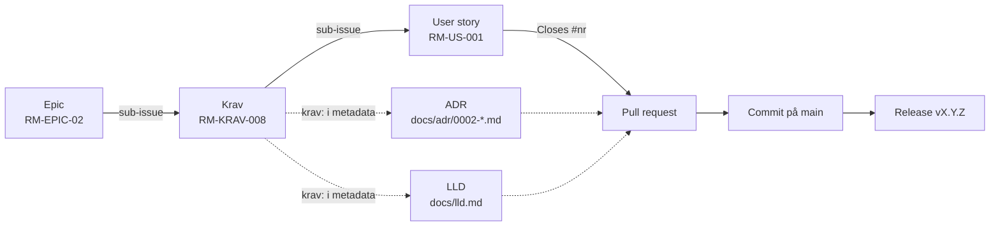

# Spårbarhet

## Hur länkarna sätts

| Från → till | Hur |
|---|---|
| Epic → krav → story | GitHub sub-issues. Varje issue har sitt ID först i titeln, t.ex. `[RM-KRAV-008]`. |
| Krav → dokument | Dokumentets metadata: `krav: [RM-KRAV-008]`. LLD har dessutom en spårbarhetstabell krav → kod. |
| Beslut → dokument | `beslut: [ADR-0002]` i metadata, och ADR:en anger vilka krav den gäller. |
| Story → PR | PR-beskrivningen har `Closes #nr` och kravets ID. `pr-trace` i CI varnar om det saknas. |
| PR → release | Releasens ändringslogg genereras från PR:erna (GitHub "Generate release notes"). |

## Baslinje

Funktioner som fanns innan arbetssättet infördes ligger som **stängda** epics och krav med etiketten `baslinje`. Det gör att LLD och ADR kan hänvisa till krav även för gammal funktionalitet.
