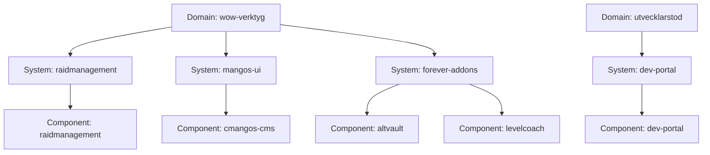

# Backstage

## Vad som finns

- **Katalogen** i `catalog/`: domäner (`wow-verktyg`, `utvecklarstod`), system (`raidmanagement`, `mangos-ui`, `forever-addons`, `dev-portal`) och ägaren `user:josemds`.
- **Komponenterna** beskrivs i varje repos `catalog-info.yaml` med `backstage.io/techdocs-ref: dir:.`, så TechDocs visar repots `docs/` vid komponenten.
- **Konfigurationen** i `backstage/app-config.dev-portal.yaml` kopplar en Backstage-app till katalogen.



## Köra lokalt (rekommenderat att börja med)

Backstage är en Node-app. Själva appen ligger **inte** i det här repot, eftersom den är stor och uppgraderas ofta. Den skapas en gång **bredvid** dev-portal (inte i `dev-portal/backstage/`, där bara konfigurationen ligger) och pekas hit.

**Förutsättningar**

- Node 22 eller 24 (LTS), kontrollera med `node -v`. Udda versioner stöds inte.
- Yarn via corepack: `corepack enable`. Installera inte Yarn globalt med npm.
- Python 3 med MkDocs för TechDocs: `pip3 install -r dev-portal/tools/requirements-docs.txt`.
- En fine-grained GitHub-token med **Contents: Read-only** på dev-portal, RaidManagement, cmangos-cms, altvault och LevelCoach.

```sh
cd ~/dev                                   # samma nivå som dev-portal
npx @backstage/create-app@latest           # namn: backstage  → ~/dev/backstage
cd backstage
export GITHUB_TOKEN=<token>
yarn start \
  --config "$PWD/app-config.yaml" \
  --config "$HOME/dev/dev-portal/backstage/app-config.dev-portal.yaml"
# öppna http://localhost:3000 → Catalog → t.ex. raidmanagement → fliken Docs
```

!!! warning "Använd absoluta sökvägar till --config"
    `yarn start` kör backend i `packages/backend`, så relativa sökvägar som `app-config.yaml` eller `../dev-portal/…` letas upp därifrån och hittas inte ("Config file … does not exist").

**Vanliga fel**

| Fel | Orsak och åtgärd |
|---|---|
| `Couldn't find a package.json file in ".../dev-portal/backstage"` | `yarn` kördes i dev-portals konfigurationsmapp. Gå till appen: `cd ~/dev/backstage`. |
| `Config file ".../packages/backend/app-config.yaml" does not exist` | Relativ sökväg till `--config`. Använd absoluta sökvägar som ovan. |
| `npm ERR! EACCES` eller fel om rättigheter i `~/.npm` när `npx` körs | Gammal npm-cache som ägs av root: `sudo chown -R $(id -u):$(id -g) ~/.npm`, kör sedan `npx` igen. |
| `yarn: command not found` eller fel Yarn-version | Kör `corepack enable` (följer med Node) och öppna en ny terminal. |
| Fel om Node-version eller native-moduler (t.ex. `isolated-vm`, `better-sqlite3`) | Byt till Node 22 eller 24 LTS (t.ex. `nvm install 22 && nvm use 22`), ta bort `node_modules` och kör `yarn install`. |
| Docs-fliken: `Failed to generate docs … caused by Error: spawn mkdocs ENOENT`, eller Safari visar "Load failed" och backend har stängts | Backstage hittar inte `mkdocs` på `PATH`. Kräver Python 3.10 eller senare. macOS-systemets Python 3.9 räcker inte, eftersom `mkdocs-techdocs-core` kräver en `pymdown-extensions` som saknas för 3.9. Kör `brew install python@3.12`, sedan `python3.12 -m venv ~/dev/backstage/.venv-techdocs` och `~/dev/backstage/.venv-techdocs/bin/pip install -r ~/dev/dev-portal/tools/requirements-docs.txt`. Starta med `PATH="$HOME/dev/backstage/.venv-techdocs/bin:$PATH" yarn start …`. |
| Komponenterna syns inte i Catalog, loggen säger `Unable to read url, no matching files found for …RaidManagement…` | `GITHUB_TOKEN` saknas i terminalen eller saknar läsrätt på de privata repona. Då faller hela katalogen bort, även de publika komponenterna. Exportera token och starta om. |
| Docs-fliken för RaidManagement eller cmangos-cms: Safari visar `TypeError: Load failed`, loggen säger `403 Forbidden … /commits/main/status` | `GITHUB_TOKEN` är en finkornig token som saknar **Commit statuses: Read** på de privata repona. Lägg till behörigheten, eller starta med `export GITHUB_TOKEN="$(gh auth token)"`. Publika repon påverkas inte. |

## Färgtema

`backstage/theme/portalTheme.ts` innehåller ett ljust och ett mörkt tema i marinblått, rött och vitt. En app som skapats med `npx @backstage/create-app` använder det nya frontend-systemet, och där läggs temat in som en modul:

1. Kopiera filen till `~/dev/backstage/packages/app/src/theme/portalTheme.ts` och kör `yarn --cwd packages/app add @backstage/theme`.
2. Skapa `packages/app/src/modules/theme/index.tsx`:

    ```tsx
    import { createFrontendModule } from '@backstage/frontend-plugin-api';
    import { ThemeBlueprint } from '@backstage/plugin-app-react';
    import { UnifiedThemeProvider } from '@backstage/theme';
    import { portalLightTheme, portalDarkTheme } from '../../theme/portalTheme';

    const portalLight = ThemeBlueprint.make({
      name: 'portal-light',
      params: { theme: { id: 'portal-light', title: 'Portal ljust', variant: 'light',
        Provider: ({ children }) => <UnifiedThemeProvider theme={portalLightTheme} children={children} /> } },
    });
    const portalDark = ThemeBlueprint.make({
      name: 'portal-dark',
      params: { theme: { id: 'portal-dark', title: 'Portal mörkt', variant: 'dark',
        Provider: ({ children }) => <UnifiedThemeProvider theme={portalDarkTheme} children={children} /> } },
    });

    export const themeModule = createFrontendModule({
      pluginId: 'app',
      extensions: [portalLight, portalDark],
    });
    ```

3. Lägg till `themeModule` i `features` i `packages/app/src/App.tsx`.
4. Lägg temana först i `app-config.yaml`, annars ligger Backstages gröna standardtema kvar som förval:

    ```yaml
    app:
      extensions:
        - theme:app/portal-light
        - theme:app/portal-dark
    ```

5. Kör `yarn tsc` och starta om `yarn start`. Standardtemana finns kvar under **Settings → Appearance**.

## Drift om den ska vara uppe hela tiden

| Alternativ | Vad som behövs | Kommentar |
|---|---|---|
| Din Mac (Undercity) | Node, Python, `yarn start` | Enklast. Bara för dig, bara när datorn är på. |
| Container på en liten VM eller hemmaserver | Docker-image från `yarn build-image`, PostgreSQL, token som secret, HTTPS | Ca 1–2 GB RAM. Lägg GitHub-inloggning framför om den nås utifrån. |
| Managed Backstage (t.ex. Roadie) | Konto, peka på `catalog/all.yaml` | Ingen drift, men kostar. |

För en publik eller delad instans: byt `techdocs.builder` till `external`, bygg dokumenten i GitHub Actions med `techdocs-cli` och lagra dem i S3, Azure Blob eller GCS.

## Lägga till en komponent

Lägg en `catalog-info.yaml` i repot (finns i [projektmallen](../nytt-projekt.md)) och en rad i `catalog/all.yaml`.
