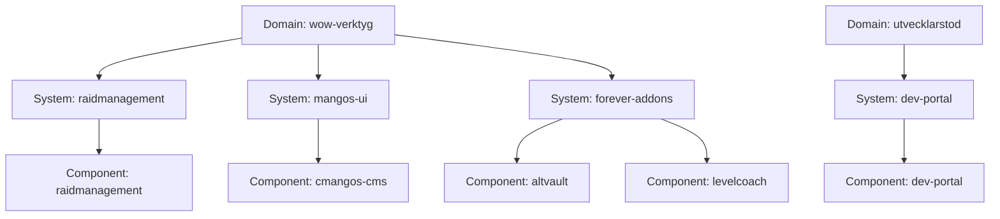

# Backstage

## Vad som finns

- **Katalogen** i `catalog/`: domäner (`wow-verktyg`, `utvecklarstod`), system (`raidmanagement`, `mangos-ui`, `forever-addons`, `dev-portal`) och ägaren `user:josemds`.
- **Komponenterna** beskrivs i varje repos `catalog-info.yaml` med `backstage.io/techdocs-ref: dir:.`, så TechDocs visar repots `docs/` vid komponenten.
- **Konfigurationen** i `backstage/app-config.dev-portal.yaml` kopplar en Backstage-app till katalogen.



## Köra lokalt (rekommenderat att börja med)

Backstage är en Node-app. Själva appen ligger inte i det här repot, eftersom den är stor och uppgraderas ofta. Den skapas en gång och pekas hit.

```sh
# Krav: Node 20 eller 22, Yarn, Python 3
npx @backstage/create-app@latest      # namn t.ex. backstage
cd backstage
pip install -r ../dev-portal/tools/requirements-docs.txt
export GITHUB_TOKEN=<fine-grained token, läsrätt på de fem repona>
yarn start --config app-config.yaml --config ../dev-portal/backstage/app-config.dev-portal.yaml
# öppna http://localhost:3000
```

## Drift om den ska vara uppe hela tiden

| Alternativ | Vad som behövs | Kommentar |
|---|---|---|
| Din Mac (Undercity) | Node, Python, `yarn start` | Enklast. Bara för dig, bara när datorn är på. |
| Container på en liten VM eller hemmaserver | Docker-image från `yarn build-image`, PostgreSQL, token som secret, HTTPS | Ca 1–2 GB RAM. Lägg GitHub-inloggning framför om den nås utifrån. |
| Managed Backstage (t.ex. Roadie) | Konto, peka på `catalog/all.yaml` | Ingen drift, men kostar. |

För en publik eller delad instans: byt `techdocs.builder` till `external`, bygg dokumenten i GitHub Actions med `techdocs-cli` och lagra dem i S3, Azure Blob eller GCS.

## Lägga till en komponent

Lägg en `catalog-info.yaml` i repot (finns i [projektmallen](../nytt-projekt.md)) och en rad i `catalog/all.yaml`.
