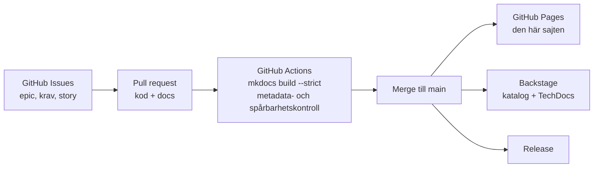

# Dev-portal

En källa för krav, design och beslut i alla projekt. Dokumenten är Markdown i Git, ändras via pull request och byggs med MkDocs. Samma filer visas här på GitHub Pages och i Backstage TechDocs.

## Var börjar jag?

- **Ny här?** Läs [Arbetssätt](arbetssatt/index.md). Det tar fem minuter.
- **Ska skriva ett dokument?** Ta en [mall](mallar/index.md). I de flesta projekt räcker LLD och ADR.
- **Letar efter ett projekt?** Se [Projekt](projekt/index.md).
- **Startar ett nytt repo?** Följ [Nytt projekt](nytt-projekt.md).
- **Arbetar med Claude?** Se [Claude-skills](skills.md).

## Principer

1. **En källa.** Det som står i repot gäller. Wiki, portal och Backstage är bara olika sätt att läsa det.
2. **Ändras via PR.** Människor äger och godkänner. Claude skriver utkast och granskar.
3. **Spårbart.** Epic → krav → story → ADR → LLD → PR → release, med länkar åt båda hållen.
4. **Lagom.** Dokumentera det som behövs för att förstå och ändra koden, inte mer.
