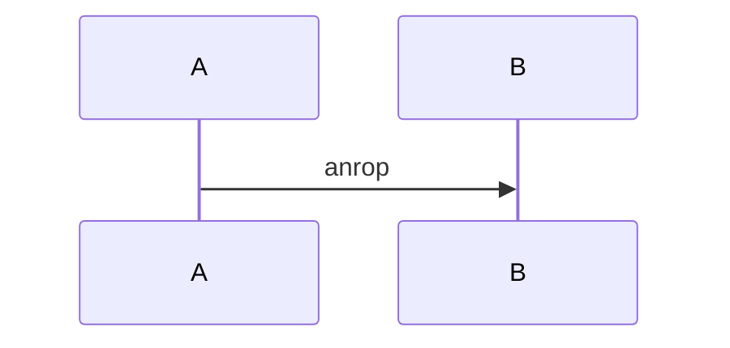

# LLD – {{PROJEKT}}

> Hur koden är byggd, så att den kan ändras säkert. Uppdateras i samma PR som koden (Claude-skill: `lld-update`).

## 1. Syfte och avgränsning
Vad komponenten gör och inte gör. En till tre meningar.

## 2. Komponenter och filer
| Del | Fil/paket | Ansvar |
|---|---|---|
| | | |

## 3. Flöden
Det viktigaste flödet som sekvens- eller flödesdiagram (Mermaid).

## 4. Gränssnitt
Kommandon, API-endpoints, protokoll, händelser. Ange ID (INT-01 …) för integrationer.

## 5. Data
Datamodell, lagring, konfiguration.

## 6. Test och kvalitet
Hur det testas lokalt och i CI.

## 7. Kända begränsningar
Med länk till krav eller issue när de ska åtgärdas.

## 8. Spårbarhet
| Krav | Var i koden | Test |
|---|---|---|
| | | |
